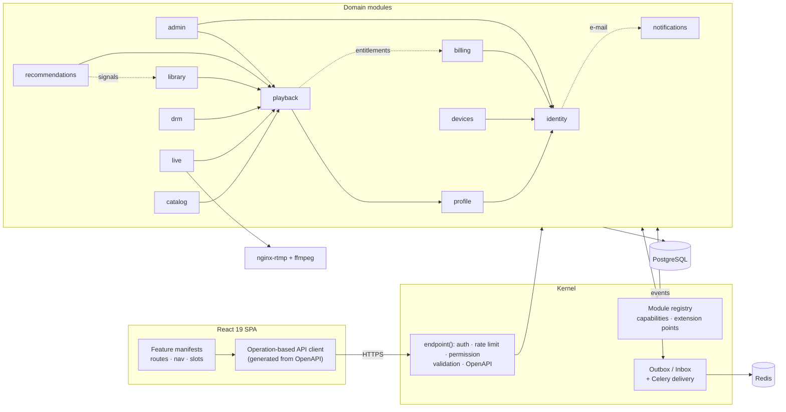

# NeoTV

**A modular IPTV / streaming platform — Flask modular monolith + React 19.**
Live channels and VOD from M3U playlists or RTMP ingest, multi-profile accounts, concurrent-stream limits,
subscriptions, DRM, recommendations and a back office — built around a small kernel whose rules are enforced by tests.

[](https://github.com/AzizNeo/NeoTV/actions/workflows/ci.yml)


<table>
  <tr>
    <td width="50%"><br><sub>Live TV with programme guide</sub></td>
    <td width="50%"><br><sub>Back office dashboard</sub></td>
  </tr>
  <tr>
    <td><br><sub>Subscription plans</sub></td>
    <td><br><sub>Sign-in (with password reset by e-mail)</sub></td>
  </tr>
</table>

<p align="center"><br><sub>Responsive mobile layout</sub></p>

<sub>Screenshots are of the seeded demo (`python -m tools.seed_demo`); refresh them with
`frontend/scripts/screenshots.mjs`. The UI language is currently Turkish.</sub>

## Highlights

- **Modular monolith with a real contract.** 12 domain modules plug into a kernel through manifests
  (capabilities, events, extension points, routes, tasks, permissions). Modules may only import each other's
  `api.py`; [import-linter](.importlinter) fails the build otherwise. Optional modules can be switched off with
  `DISABLED_MODULES` and dependants degrade gracefully — or fail at boot with a *named* error.
- **Transactional outbox / inbox.** Domain changes and their events commit atomically; consumers are idempotent,
  retried with exponential backoff and dead-lettered. E-mail delivery, watch history and the recommendation read
  model all ride on it.
- **Streaming pipeline.** Playback gate with per-plan concurrent-stream slots, signed media grants, an upstream HLS
  proxy that re-signs every segment/key URI, RTMP ingest with ABR transcoding (ffmpeg, hardware encoders first),
  and QoE beacons. The player picks hls.js, native HLS or Shaka (EME) per source.
- **DRM.** Envelope-encrypted content keys (rotatable KEK), session-bound licenses, AES-128 key delivery and a
  pluggable license-issuer extension point (ClearKey built in).
- **Security by default.** Stateless access tokens + rotating refresh tokens with reuse detection, login throttling,
  password policy, account recovery with hashed single-use links (secret in the URL fragment, no account
  enumeration), SSRF-guarded egress, signed webhooks.
- **Quality gates.** 180+ backend tests (unit, contract, end-to-end, migration chain, PostgreSQL + Redis
  integration, architecture fitness), 20+ frontend tests, ruff + mypy + ESLint, hash-locked dependencies, secret
  scanning, and a **fresh-install smoke test on Windows and Linux** on every push.

## Architecture



Solid arrows are required capabilities, dotted ones optional (the consumer works without them). Every module
follows the same layout:

```
app/modules/<name>/
  manifest.py   what it provides / requires / subscribes to (the only thing the kernel reads)
  api.py        public surface for other modules (Protocols + DTOs)
  domain.py     rules and named errors        services.py   use cases (Unit of Work)
  models.py     tables                         http.py       routes via endpoint()
  handlers.py   event consumers                tasks.py      Celery tasks
```

| Module | Responsibility |
|---|---|
| `identity` | Accounts, access/refresh tokens, roles, e-mail verification, password reset |
| `notifications` | Transactional e-mail: module-owned templates, pluggable transports (SMTP/console/memory) |
| `profile` | Viewer profiles, PIN lock, profile context tokens |
| `devices` | Device inventory; revoking a device ends its sessions and streams |
| `catalog` | Channels and VOD from M3U playlists (async import, probing, dedupe) |
| `live` | External HLS or RTMP-ingested live channels, ABR transcoding, EPG |
| `playback` | Playback gate, stream slots, signed grants, HLS proxy, QoE |
| `billing` | Plan catalogue, subscription state machine, signed PSP webhooks |
| `drm` | Content keys, licenses, key delivery, policies |
| `library` | Favourites, resume positions, watch history |
| `recommendations` | Trending and personalised rows from playback events |
| `admin` | Dashboard, user moderation, live sessions, abuse detection rules |

More detail (in Turkish): [architecture audit](docs/MIMARI_DENETIM_RAPORU.md) ·
[implementation notes](docs/IMPLEMENTATION_NOTES.md).

## Tech stack

| Backend | Frontend | Infrastructure |
|---|---|---|
| Python 3.12–3.14, Flask 3.1, SQLAlchemy 2, Alembic, Pydantic 2, Celery 5 | React 19, Vite 7, React Router 7, TanStack Query 5, Zod | PostgreSQL 16, Redis 7, nginx + nginx-rtmp, ffmpeg |
| pytest, ruff, mypy, import-linter | Vitest, Testing Library, ESLint | GitHub Actions, Docker, gitleaks, uv (locks) |

## Getting started

Requirements: Python 3.12+ and Node.js 20+. Redis and PostgreSQL are **not** needed for local development
(SQLite, an in-process Redis and eager Celery are used).

**Windows** — double-click `Kurulum.bat` once (setup), then `Baslat.bat` every day.

**Any OS**

```bash
python -m venv .venv && source .venv/bin/activate            # Windows: .venv\Scripts\activate
pip install --require-hashes --only-binary=:all: -r requirements-dev.lock
python -m tools.devctl init-env --local-dev                  # .env with a fresh SECRET_KEY, no Redis needed
python -m tools.devctl migrate                               # backs up the DB, then upgrades
python -m tools.devctl create-admin --username admin
(cd frontend && npm ci)
python -m tools.seed_demo                                    # optional: public test streams
python -m tools.devctl run                                   # API + frontend → http://127.0.0.1:5173
```

In development, e-mails are written to `var/mail/*.eml` and their links are printed to the console.

## Quality gates

```bash
pytest                                                       # SQLite + in-process Redis
TEST_DATABASE_URL=postgresql://… TEST_REDIS_URL=redis://… pytest tests/integration
ruff check . && ruff format --check . && mypy && lint-imports
(cd frontend && npm run lint && npm test -- --run && npm run build)
python -m tools.smoke_boot                                   # fresh install → API → login → password reset by e-mail
```

CI runs all of the above on every push — backend on PostgreSQL + Redis, the smoke test on Windows (Python 3.12
and 3.14) and Linux — plus a pinned, checksum-verified secret scan and Docker image builds.

## Project layout

```
app/kernel/        container, module registry, endpoint(), outbox, security, settings
app/modules/       domain modules (see above) + _template for `flask kernel new-module`
app/shared_kernel/ events and value objects shared by modules
frontend/src/      core/ (API client, auth, featureKit) · shared/ · features/ · app/
migrations/        Alembic chain (one module per revision)
tests/             unit · contract · e2e · fitness · migrations · integration
tools/             devctl (setup/run), smoke_boot, seed_demo, lock_deps
```

## Content and legal

NeoTV ships **no channels or media**. The demo seeds only streams published for player testing: Blender
Foundation open movies — *Big Buck Bunny*, *Sintel*, *Tears of Steel* (© Blender Foundation,
[CC BY](https://creativecommons.org/licenses/by/3.0/), [blender.org](https://www.blender.org/about/projects/)) —
and public HLS test streams from Apple, Akamai and Unified Streaming, played straight from their hosts. The demo
artwork is original (`tools/demo_art.py`). Use NeoTV with content you are licensed to distribute.

## License

[MIT](LICENSE) © 2026 AzizNeo
