# NeoTV

**A modular IPTV / streaming platform — Flask modular monolith + React 19.**
Live channels and VOD from M3U playlists or RTMP ingest, multi-profile accounts, concurrent-stream limits,
subscriptions, DRM, recommendations and a back office — built around a small kernel whose rules are enforced by tests.

[](https://github.com/AzizNeo/NeoTV/actions/workflows/ci.yml)


[](#quality-gates)
[](#quality-gates)

<p align="center">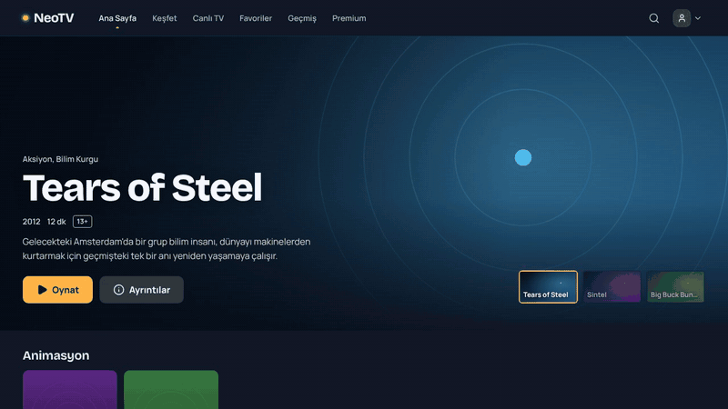</p>

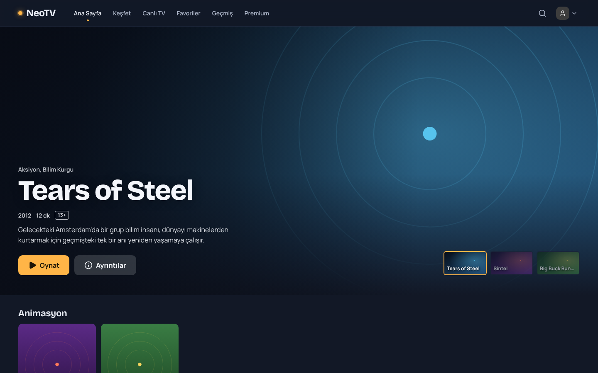

<table>
  <tr>
    <td width="50%">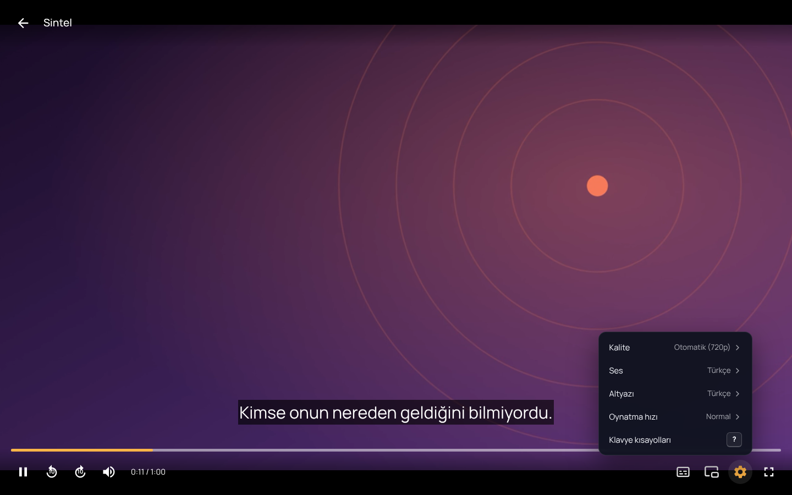<br><sub>Player — quality, audio and subtitle choice, remembered per device</sub></td>
    <td width="50%">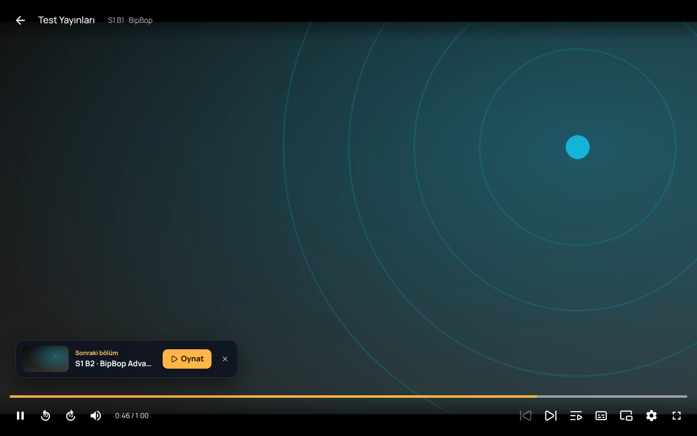<br><sub>"Next episode" during the credits, countdown at the end</sub></td>
  </tr>
  <tr>
    <td>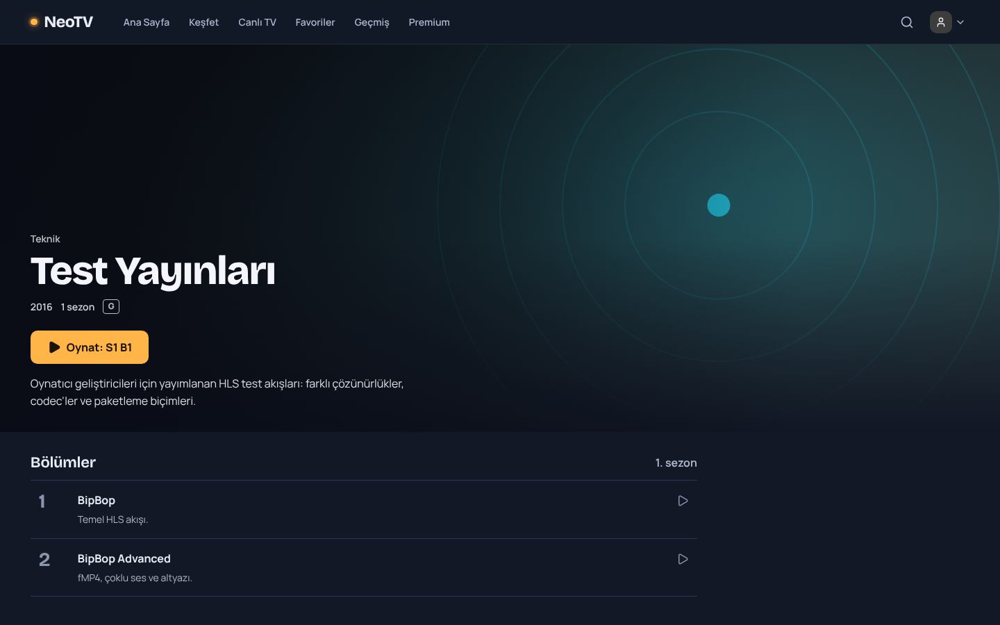<br><sub>Series page — resume where you left off</sub></td>
    <td>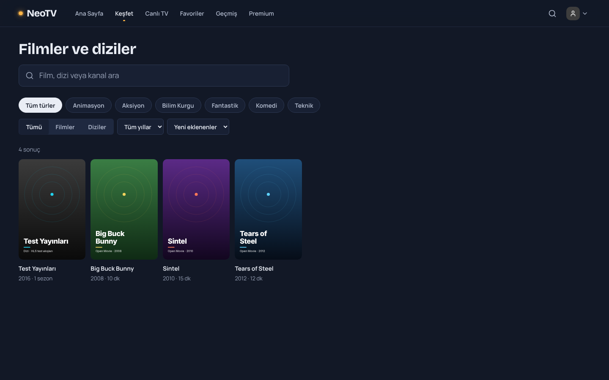<br><sub>Browse — genre, type, decade and sort, all in the URL</sub></td>
  </tr>
  <tr>
    <td>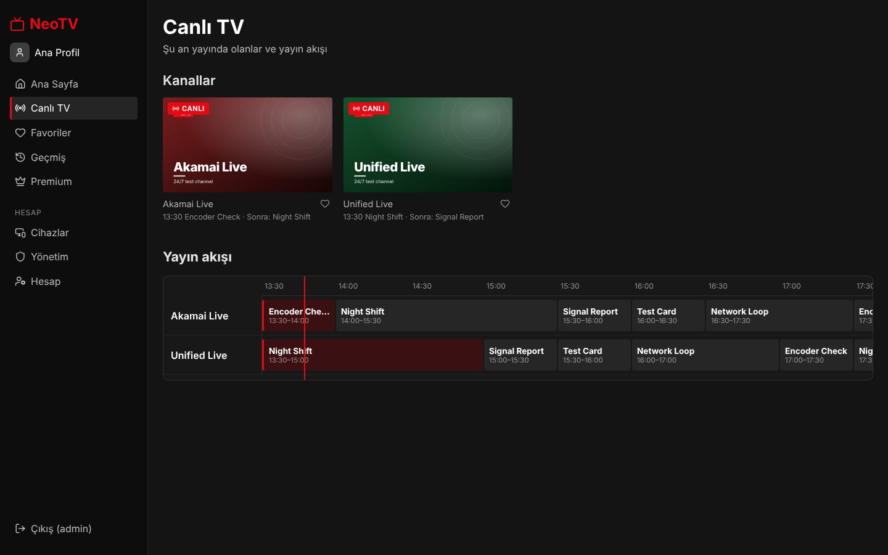<br><sub>Live TV with programme guide</sub></td>
    <td>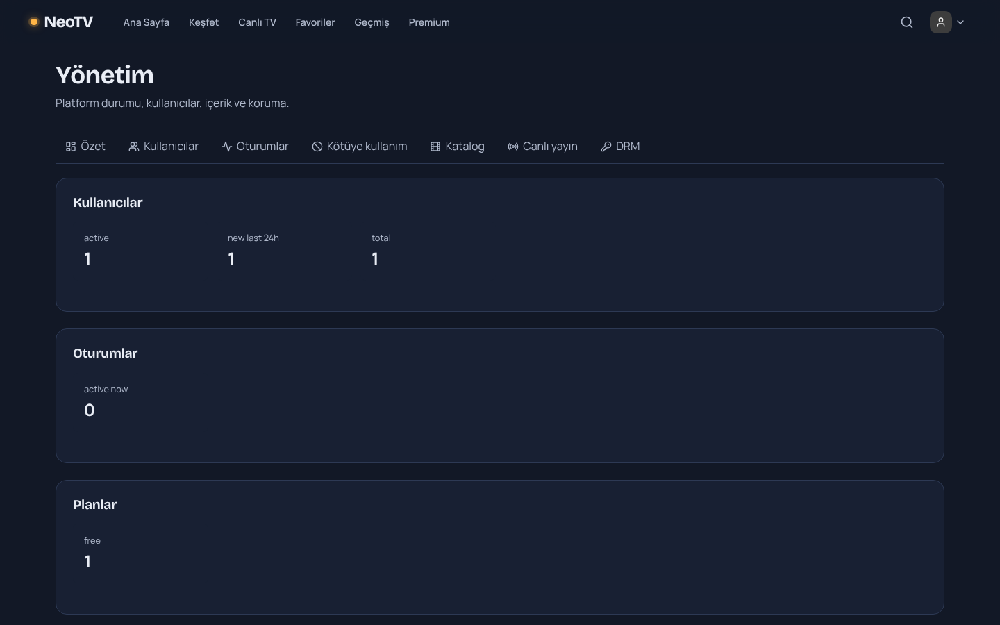<br><sub>Back office dashboard</sub></td>
  </tr>
  <tr>
    <td>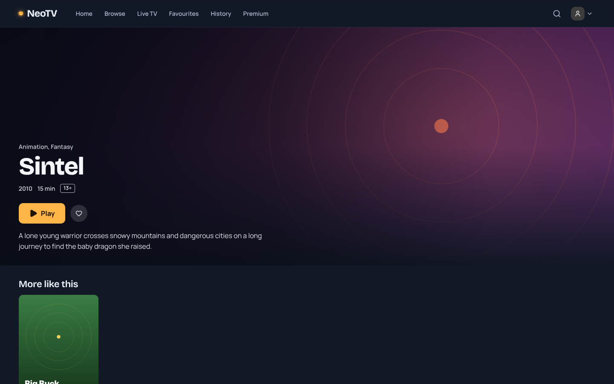<br><sub>Turkish and English, per account (e-mails included)</sub></td>
    <td>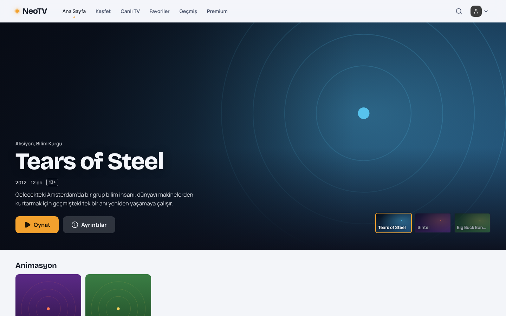<br><sub>Dark and light themes</sub></td>
  </tr>
  <tr>
    <td>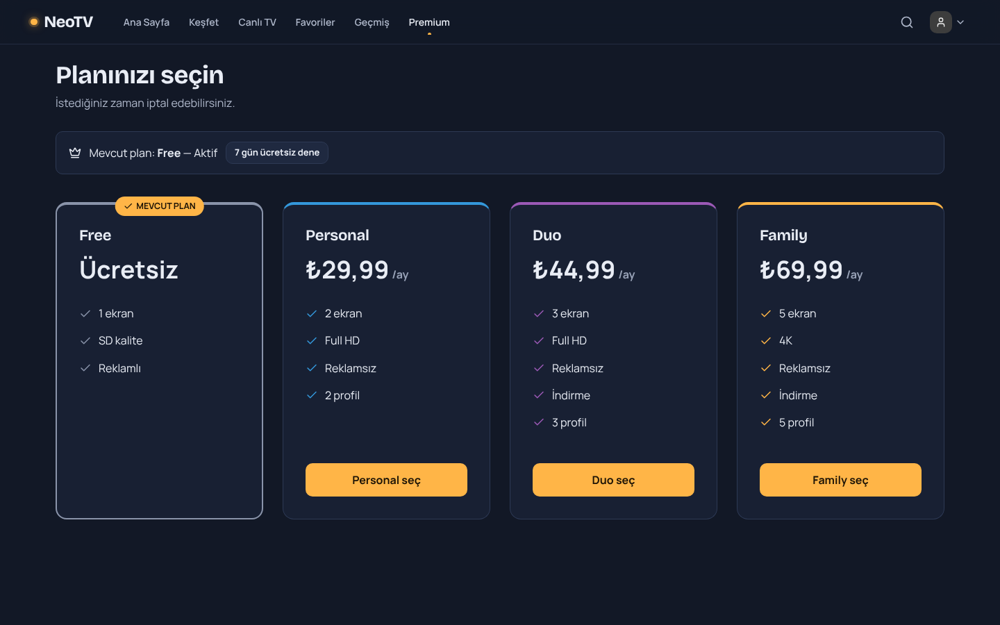<br><sub>Subscription plans</sub></td>
    <td>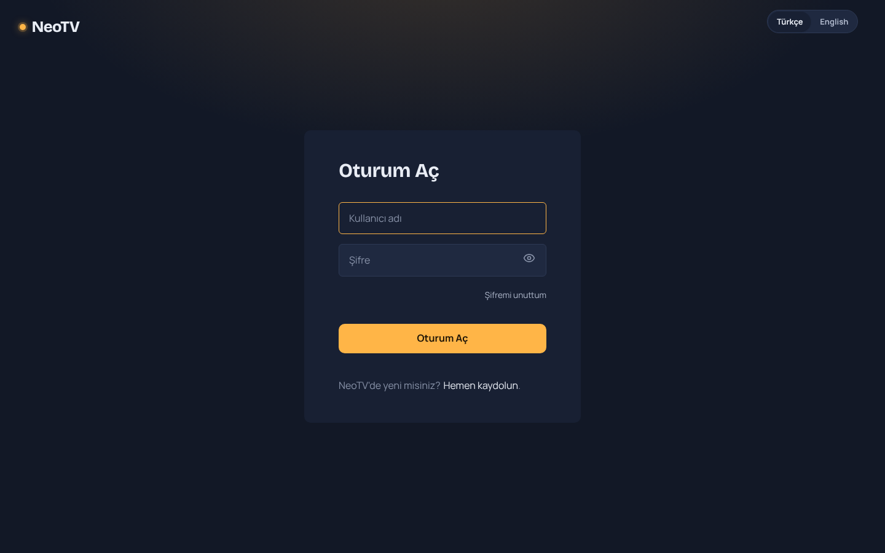<br><sub>Sign-in (with password reset by e-mail)</sub></td>
  </tr>
</table>

<p align="center">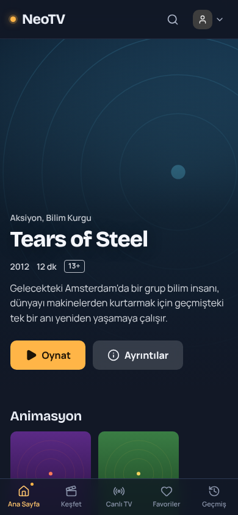<br><sub>Responsive mobile layout</sub></p>

<sub>Screenshots and the GIF come from the seeded demo (`python -m tools.seed_demo`) and are reproducible with
`frontend/scripts/screenshots.mjs`. Artwork is original (`tools/demo_art.py`); the open movies' streams are
© Blender Foundation (CC BY). In the captures the video is a locally generated clip of that artwork, since
the capture machine has no internet access.</sub>

## Highlights

- **Modular monolith with a real contract.** 15 domain modules plug into a kernel through manifests
  (capabilities, events, extension points, routes, tasks, permissions). Modules may only import each other's
  `api.py`; [import-linter](.importlinter) fails the build otherwise. Optional modules can be switched off with
  `DISABLED_MODULES` and dependants degrade gracefully — or fail at boot with a *named* error.
- **Transactional outbox / inbox.** Domain changes and their events commit atomically; consumers are idempotent,
  retried with exponential backoff and dead-lettered. E-mail delivery, watch history and the recommendation read
  model all ride on it.
- **Streaming pipeline.** Playback gate with per-plan concurrent-stream slots, signed media grants, an upstream HLS
  proxy that re-signs every segment/key URI, RTMP ingest with ABR transcoding (ffmpeg, hardware encoders first),
  and QoE beacons. The player picks hls.js, native HLS or Shaka (EME) per source.
- **DRM.** Envelope-encrypted content keys (rotatable KEK), session-bound licenses, AES-128 key delivery and a
  pluggable license-issuer extension point (ClearKey built in).
- **Security by default.** Stateless access tokens + rotating refresh tokens with reuse detection, login throttling,
  password policy, account recovery with hashed single-use links (secret in the URL fragment, no account
  enumeration), e-mail change confirmed from the new inbox with a takeover-proof undo link for the old one,
  security notices (password changed, sign-in from a new device), SSRF-guarded egress, signed webhooks.
- **Viewer experience.** Storefront with hero, genre rails and URL-driven browse; series pages that resume
  where you left off; a player with quality / audio / subtitle menus on one track model for every engine,
  picture-in-picture, OS media controls, a `?` shortcut sheet generated from the same table as the key handler,
  live-TV zapping by arrow keys or channel number, and Netflix-style post-play.
- **TV apps (Xtream-compatible player API).** IPTV apps on smart TVs and boxes (TiviMate, IPTV Smarters …)
  sign in with per-device app credentials from Account → TV apps — never the account password — and see the
  same catalogue, plan limits and kids rules as the web player: `player_api.php`, `xmltv.php`, `get.php` and
  HLS stream URLs that open a normal playback session and redirect to the signed proxy. Credentials are masked
  in every log and trace, and guessing is capped per address
  ([ADR-0011](docs/adr/0011-xtream-compatible-player-api.md)).
- **Two languages, one contract.** Each feature owns its TR/EN catalog; a missing key, language or placeholder
  fails at start-up (and in tests), never on screen. The account language follows the user across devices and
  into e-mails ([ADR-0002](docs/adr/0002-i18n-feature-owned-catalogs.md)).
- **Quality gates.** 180+ backend tests (unit, contract, end-to-end, migration chain, PostgreSQL + Redis
  integration, architecture fitness), 65+ frontend tests, ruff + mypy + ESLint, hash-locked dependencies, secret
  scanning, and a **fresh-install smoke test on Windows and Linux** on every push. Decisions are recorded as
  [ADRs](docs/adr/).

## Architecture

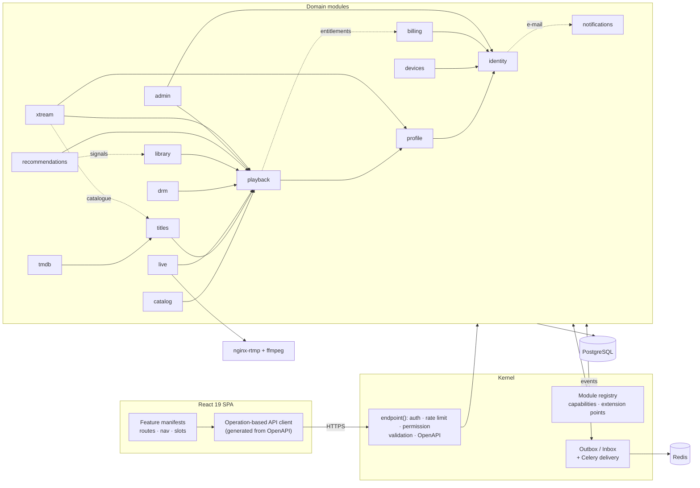

Solid arrows are required capabilities, dotted ones optional (the consumer works without them). Every module
follows the same layout:

```
app/modules/<name>/
  manifest.py   what it provides / requires / subscribes to (the only thing the kernel reads)
  api.py        public surface for other modules (Protocols + DTOs)
  domain.py     rules and named errors        services.py   use cases (Unit of Work)
  models.py     tables                         http.py       routes via endpoint()
  handlers.py   event consumers                tasks.py      Celery tasks
```

| Module | Responsibility |
|---|---|
| `identity` | Accounts, access/refresh tokens, roles, e-mail verification, password reset |
| `notifications` | Transactional e-mail: module-owned templates, pluggable transports (SMTP/console/memory) |
| `profile` | Viewer profiles, PIN lock, profile context tokens |
| `devices` | Device inventory; revoking a device ends its sessions and streams |
| `catalog` | Channels and VOD from M3U playlists (async import, probing, dedupe) |
| `titles` | Storefront layer: movies and series → seasons → episodes, genres, artwork, featured rows — pointing at playable content |
| `live` | External HLS or RTMP-ingested live channels, ABR transcoding, EPG |
| `playback` | Playback gate, stream slots, signed grants, HLS proxy, QoE |
| `billing` | Plan catalogue, subscription state machine, signed PSP webhooks |
| `drm` | Content keys, licenses, key delivery, policies |
| `library` | Favourites, resume positions, watch history |
| `recommendations` | Trending and personalised rows from playback events |
| `admin` | Dashboard, user moderation, live sessions, abuse detection rules |

How it got here: [ADR-0010](docs/adr/0010-from-audit-to-rewrite.md) (the audit of the prototype and where each finding
is handled) · adding modules, features and e-mail providers: [CONTRIBUTING.md](CONTRIBUTING.md).

## Tech stack

| Backend | Frontend | Infrastructure |
|---|---|---|
| Python 3.12–3.14, Flask 3.1, SQLAlchemy 2, Alembic, Pydantic 2, Celery 5 | React 19, Vite 7, React Router 7, TanStack Query 5, Zod | PostgreSQL 16, Redis 7, nginx + nginx-rtmp, ffmpeg |
| pytest, ruff, mypy, import-linter | Vitest, Testing Library, ESLint | GitHub Actions, Docker, gitleaks, uv (locks) |

## Getting started

### Try it in one command (Docker)

Only [Docker](https://www.docker.com/products/docker-desktop/) is needed — no Python, Node or `.env`:

```bash
docker compose -f compose.demo.yml up --build --wait     # Windows: double-click Demo.bat
docker compose -f compose.demo.yml logs --no-log-prefix setup   # the sign-in box
```

Open <http://localhost:8080> and sign in as `demo` with the password from the box. The admin
password and `SECRET_KEY` are generated on first start and kept in the demo's own volume (never
in the repo); `docker compose -f compose.demo.yml down -v` wipes everything. With
`TMDB_READ_TOKEN` in a `.env` next to the file, setup also imports TMDB artwork and synopses.
The demo listens on `127.0.0.1` only and is not the production stack (`docker-compose.yml`) —
see [ADR-0005](docs/adr/0005-one-command-docker-demo.md).

### Develop locally

Requirements: Python 3.12+ and Node.js 20+. Redis and PostgreSQL are **not** needed for local development
(SQLite, an in-process Redis and eager Celery are used).

**Windows** — double-click `Kurulum.bat` once (setup), then `Baslat.bat` every day.

**Any OS**

```bash
python -m venv .venv && source .venv/bin/activate            # Windows: .venv\Scripts\activate
pip install --require-hashes --only-binary=:all: -r requirements-dev.lock
python -m tools.devctl init-env --local-dev                  # .env with a fresh SECRET_KEY, no Redis needed
python -m tools.devctl migrate                               # backs up the DB, then upgrades
python -m tools.devctl create-admin --username admin
(cd frontend && npm ci)
python -m tools.seed_demo                                    # optional: public test streams
python -m tools.devctl run                                   # API + frontend → http://127.0.0.1:5173
```

In development, e-mails are written to `var/mail/*.eml` and their links are printed to the console.

## Quality gates

```bash
pytest                                                       # SQLite + in-process Redis
TEST_DATABASE_URL=postgresql://… TEST_REDIS_URL=redis://… pytest tests/integration
pytest --cov --cov-report=json && python -m tools.coverage_report coverage.json   # coverage per module vs. floors
ruff check . && ruff format --check . && mypy && lint-imports
(cd frontend && npm run lint && npm run coverage && npm run build)
(cd frontend && npx playwright install chromium && npm run e2e)   # browser tests (E2E_OFFLINE=1: no internet)
python -m tools.smoke_boot                                   # fresh install → API → login → password reset by e-mail
```

CI runs all of the above on every push — backend on PostgreSQL + Redis, the smoke test on Windows (Python 3.12
and 3.14) and Linux — plus a pinned, checksum-verified secret scan, Docker image builds, the one-command demo started and
smoke-tested end to end, the Playwright browser suite, a k6 load smoke against that demo, and the alerting rules' behaviour tests (`promtool`).

**Browser tests run the production build under the production CSP** (`vite preview` serves the same header file
as nginx) against a fresh, seeded backend. Besides its own assertions, every test fails on any CSP violation or
uncaught page error, so a feature that only works with a loosened policy cannot land, and every page is checked with axe
against WCAG 2.2 AA in both the light and the dark theme. They cover sign-in/out,
browse, the title page, live TV, switching language, the admin panel, real HLS playback, and that a proxied
stream's origin URL never reaches the browser.

**Load tests are judged by the production SLOs** ([`deploy/load/neotv.js`](deploy/load/neotv.js), k6). Virtual
viewers browse, open a stream, send heartbeats, report QoE and release it, while sign-ins run alongside; the run
fails if server errors exceed 0.5 %, p99 latency exceeds 1 s, or a single request is rate limited — the limits stay
on, and a 429 means the test's pacing, not the system, is wrong. CI runs a short smoke on every push through the
demo stack; the *Load test* workflow (Actions → Run workflow) measures capacity with a chosen number of viewers.
Accounts come from `python -m tools.load_seed` (never in production). Findings: [ADR-0009](docs/adr/0009-load-testing.md).

**Coverage is measured per module**, the unit this codebase is built from. Each backend module has a floor in
`pyproject.toml` (`[tool.neotv.coverage]`); dropping below it fails CI *by module name*, a new module without a
floor is refused, and a module that stays well above its floor is flagged so the floor can be raised — a ratchet,
never lowered to make a build pass. The per-module tables land on each CI run's summary page and the HTML reports
are kept as artifacts. Today: backend ≈ 83% (statements + branches, lowest: `live` — ffmpeg process supervision —
and `catalog` — remote playlist fetching), frontend ≈ 25% (unit tests cover logic — player, i18n, routing
contracts; user flows are covered by the browser tests).

## Observability

Built to be trusted, not just present — the reasoning is in [ADR-0008](docs/adr/0008-observability.md).

| | Where | What |
| --- | --- | --- |
| **Metrics** | `GET /api/v1/kernel/metrics` (Prometheus; `METRICS_TOKEN`) | HTTP traffic and latency, stream opens and active streams, time to first frame, rebuffering and stalls by device, origin failures by cause, outbox lag and dead letters, circuit breakers, Web Vitals and browser errors. Correct under several gunicorn workers (multiprocess mode). |
| **Traces** | OpenTelemetry → `OTEL_ENDPOINT` (OTLP/HTTP) | One trace per request: browser call → Flask → SQL → outbound HTTP → Celery task. Off unless configured; `OTEL_SAMPLE_RATIO` decided by the server. |
| **Logs** | stdout, JSON | Every line carries `request_id`, and `trace_id`/`span_id` when traced. Browser errors arrive as `client` log lines, scrubbed of tokens and query strings. |
| **SLOs and alerts** | [`deploy/prometheus/`](deploy/prometheus) | API availability 99.5 %, latency 99 % ≤ 1 s, playback start 95 % ≤ 3 s; multi-window burn-rate alerts plus operational alerts — unit-tested with `promtool`. |
| **Runbooks** | [`docs/runbooks.md`](docs/runbooks.md) | What to check and do for every alert (a test keeps alerts and runbooks in step). |
| **Dashboard** | [`deploy/grafana/neotv-overview.json`](deploy/grafana/neotv-overview.json) | Import into Grafana and pick a Prometheus source: error budgets, API, playback, platform, browsers. |

Rules and dashboard are generated from short sources (`generate_rules.py`, `generate_dashboard.py`);
CI fails if a generated file is stale, a rule misbehaves, a dashboard query does not parse or names
a series that does not exist, or an exported metric is on no panel.

## Project layout

```
app/kernel/        container, module registry, endpoint(), outbox, security, settings
app/modules/       domain modules (see above) + _template for `flask kernel new-module`
app/shared_kernel/ events and value objects shared by modules
frontend/src/      core/ (API client, auth, featureKit) · shared/ · features/ · app/
migrations/        Alembic chain (one module per revision)
tests/             unit · contract · e2e · fitness · migrations · integration
tools/             devctl (setup/run), smoke_boot, seed_demo, lock_deps
```

## Content and legal

NeoTV ships **no channels or media**. The demo seeds only streams published for player testing: Blender
Foundation open movies — *Big Buck Bunny*, *Sintel*, *Tears of Steel* (© Blender Foundation,
[CC BY](https://creativecommons.org/licenses/by/3.0/), [blender.org](https://www.blender.org/about/projects/)) —
and public HLS test streams from Apple, Akamai and Unified Streaming, played straight from their hosts. The demo
artwork is original (`tools/demo_art.py`). Use NeoTV with content you are licensed to distribute. The
Xtream-compatible player API serves only this catalogue to the viewer's own apps; it provides no content of its own.

## Security

Please report vulnerabilities privately — see [SECURITY.md](SECURITY.md). Contributions: [CONTRIBUTING.md](CONTRIBUTING.md).

## License

[MIT](LICENSE) © 2026 AzizNeo
